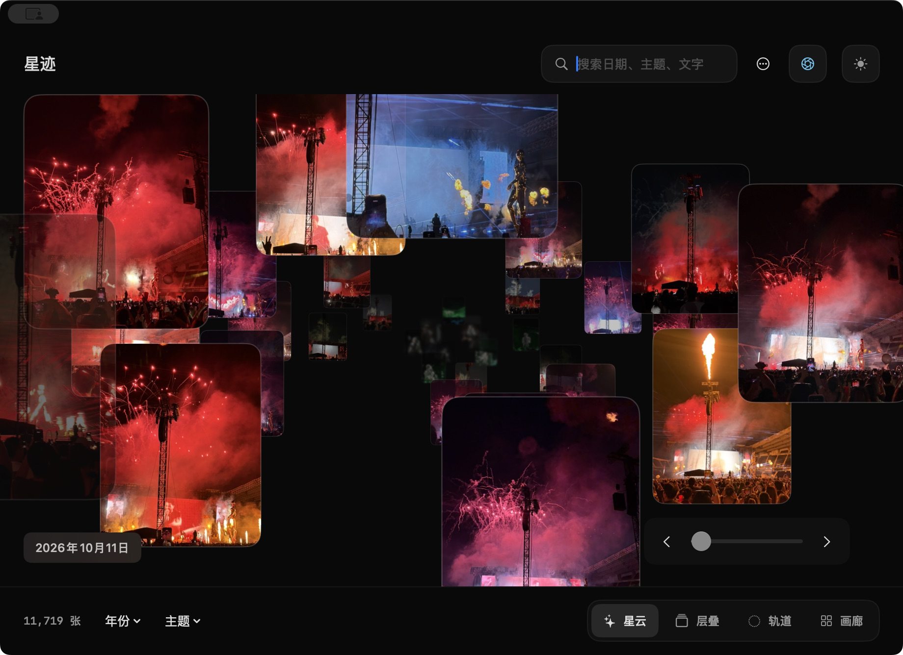

# 星迹 v1.2

v1.2 重点改善大型照片库中的浏览流畅度，同时保留原有四种模式、相机动画、景深效果与纯色背景。



## 本版更新

- 将缩略图色彩转换提前到后台，减少星云滚动时主线程的图片准备压力；照片颜色与清晰度已在真实图库中确认正常。
- 隔离画廊日期、悬停和静态卡片更新，减少滚动时的重复重建。
- 优化层叠总览的卡组封面计算；返回卡组后保持原来的日期位置。
- 修复拖动位置滑块后偶尔无法继续滚动或拖拽的问题。
- 新增 ⌘F 搜索、⌘1—⌘4 模式切换，以及原生“浏览”“图库”菜单。
- 星云不再显示缩略图实况角标；大图长按播放实况不受影响。画廊角标使用轻量纯色样式。

## 安装

下载 `XingJi-1.2.zip`，解压后把 `星迹.app` 拖进“应用程序”。需要 macOS 15 或更高版本，支持 Apple Silicon 与 Intel Mac。

当前安装包为 ad-hoc 签名，未经过 Apple Developer ID 公证。首次打开可能被 Gatekeeper 拦截；确认来源后可在 Finder 中右键应用并选择“打开”。照片访问仍由 macOS 系统授权，应用不修改或删除苹果相册原图。

## 校验

`XingJi-1.2.zip` SHA-256：

```
a6dab959e9082d633db9e12d25b7c77f54a173f7ebbdff2468597748eec6ef74
```

完整构建、签名检查及本机工作流测试已在发布前执行。
